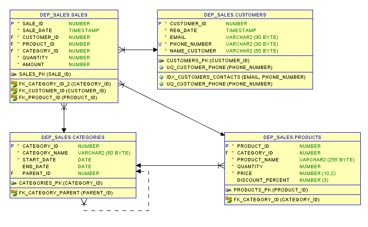
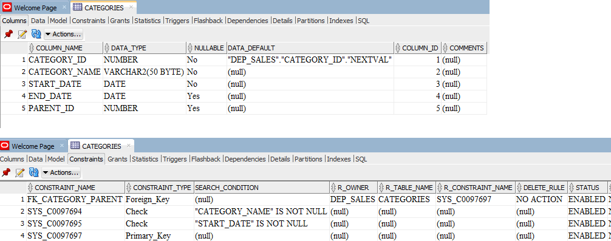
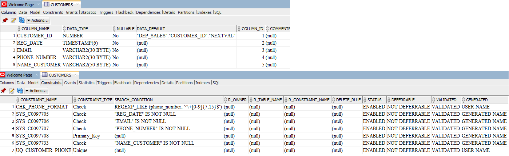
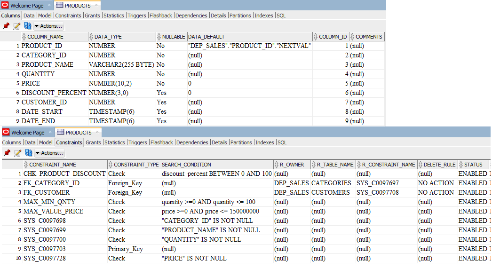
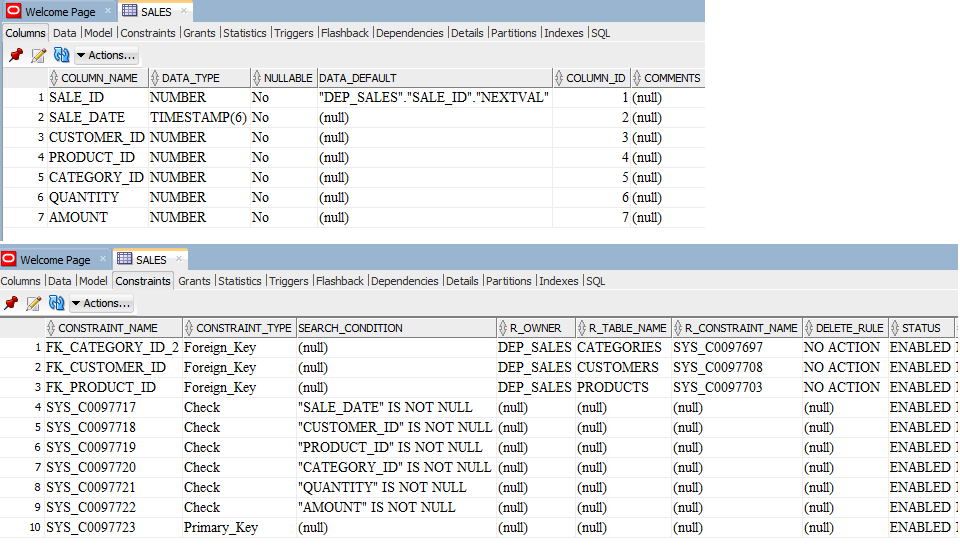

# about project "sales department"
 
Данный проект представляет собой минимизированный набор данных и таблиц для обработки аналитических запросов.

 
Предполагается, что есть отдел продаж с информацией о продуктах, категориях, суммах и даты продажи.

 
Необходимо выгрузить данные согласно поставленным задачам и построить графики/дашброды (визуализировать данные) в программе POWER BI.

 
Схема БД:

 
 
 
 [Схема](https://github.com/OlgaSelivanova1/project-sales-department/blob/main/tables.png/tables/all_tables_inschema.png)

 
 
 
 
 
 
<strong>Список задач</strong>

 
 [Задачи по уровню сложности](https://github.com/OlgaSelivanova1/project-sales-department/tree/main/tasks_query)

 
<strong>Решения</strong>

 [Папки по номерам вопросов](https://github.com/OlgaSelivanova1/project-sales-department/tree/main/tasks_query/junior)
