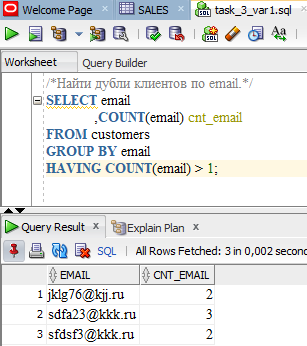

# Что хранится в данной папке
<li>Схема, таблицы, поля, ограничения</li>

<li>скрипты-изменения в схеме БД "dep_sales", которые необходимы для корректной работы.</li>
<li>Добавление новых столбцов для связки таблиц</li>
<li>Добавление индексов на столбцы для быстрого поиска информации(оптимизации)</li>
<li>Информацию о составе таблиц(колонки, типы данных, хранимая информация)

<strong>Все данные в таблицах тестовые</strong>

<strong>Поэтому данные, относящиеся к первичной информации клиентов, "в свободном доступе"</strong>

