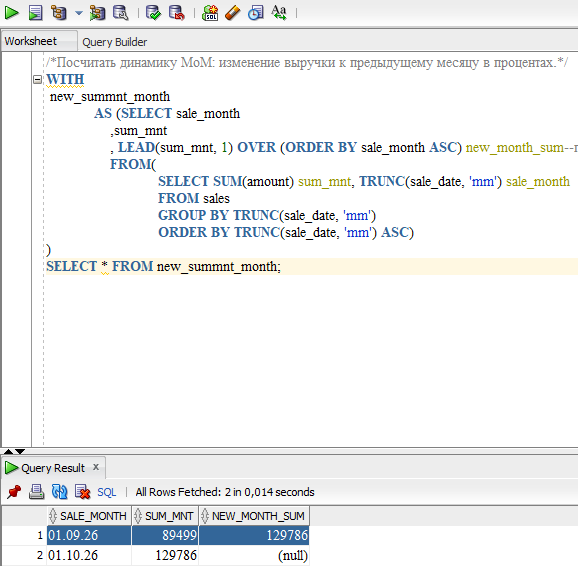
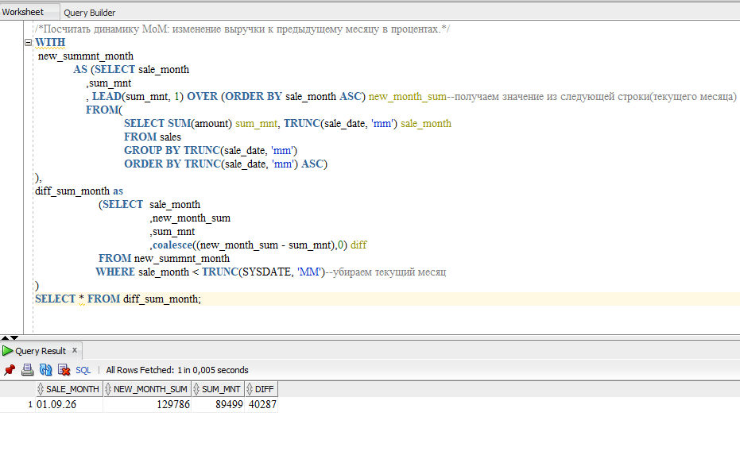
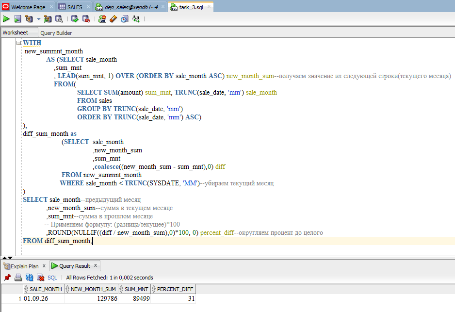
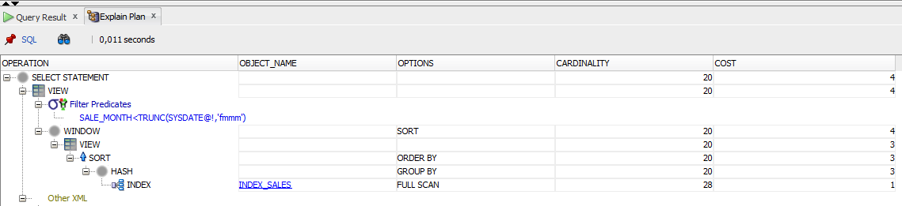

## Посчитать динамику MoM: изменение выручки к предыдущему месяцу в процентах
Выполним задачу поэтапно с помощью CTE
1. Найдем общую сумму продаж текущего и предыдущего месяца
2. Применим LEAD для получения доп. столбца: Сумма текущего месяца в строке предыдщущего

3. Вычислим разницу между текущим и предыдущим значениями
4. Уберем текущий месяц (в нем есть поля NULL и он не нужен)

5. Производим итоговое вычисление: находим процент: разница между предыдущим месяцем от текущего

Но если нужна динамика, тогда текущий месяц можно не убирать

