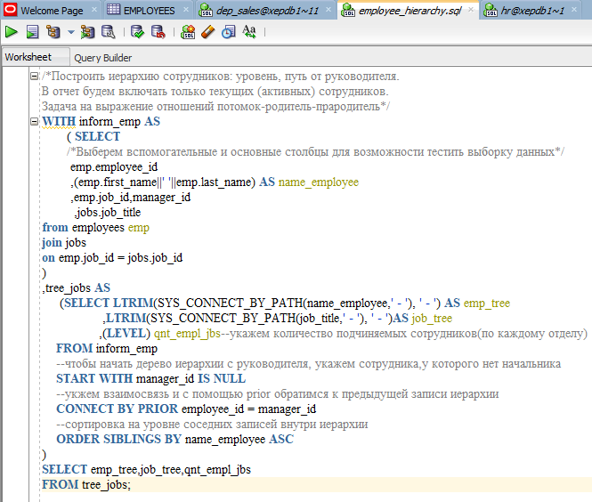
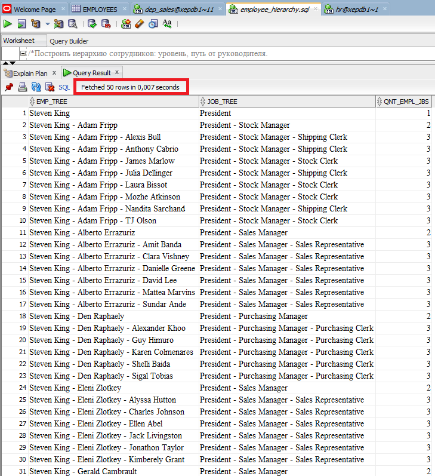
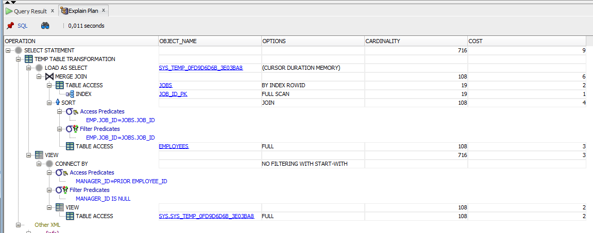

# Построить иерархию сотрудников: уровень, путь от руководителя.

Для решения этой задачи применим CONNECT BY, а затем отформатируем вывод требуемым образом с помощью функции SYS_CONNECT_BY_PATH.

Результатирующую выборку отфильтруем по псевдостолбцу LEVEL

Я дополнила вывод с иерархией по отделам в соотвествии иерархии подчинения (ФИ) сотрудников

Полный вывод в в файле:
  
  [View raw](https://github.com/OlgaSelivanova1/project-sales-department/blob/main/tasks_query/middle/task_6/records/all_rows_result.xlsx)

