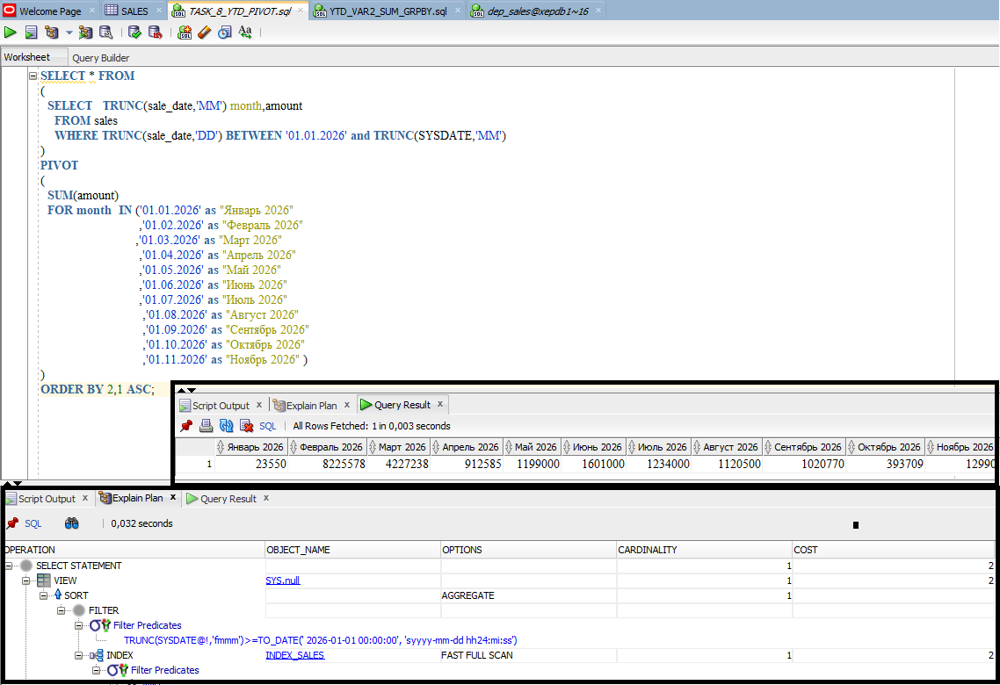
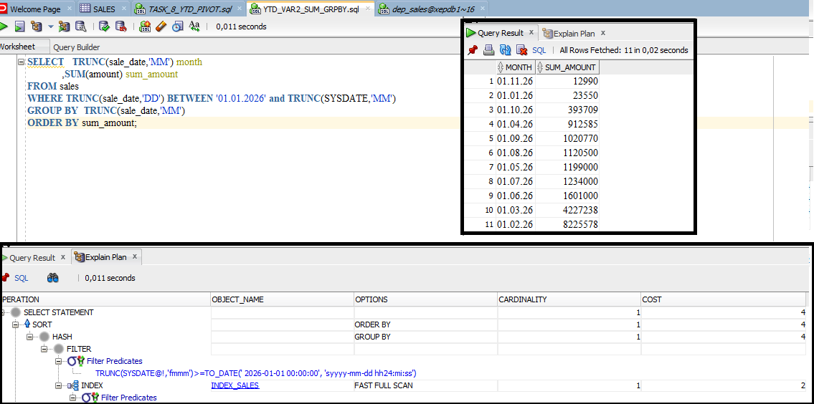
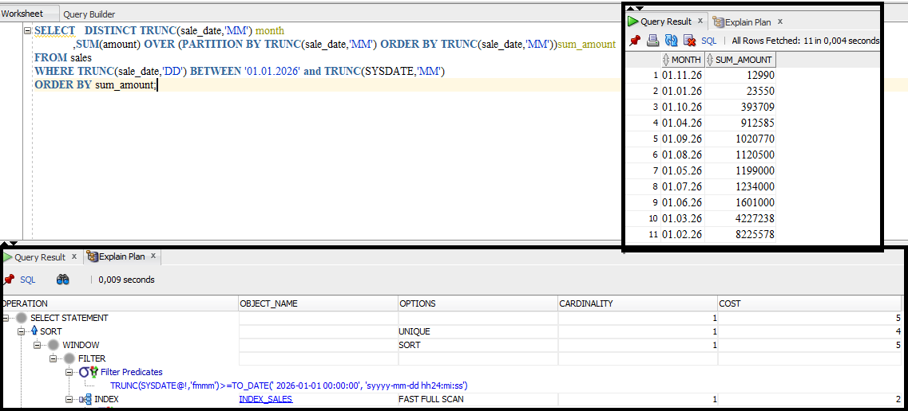

# Посчитать YTD-выручку.
Данную задачу я решила 3-мя способами
## I вариант с PIVOT

(для удобства отображения информации)

## II вариант

с помощью агрегатной функции SUM + GROUP BY ПО МЕСЯЦАМ

## III вариант 

с помощью оконной функции SUM() OVER ()

