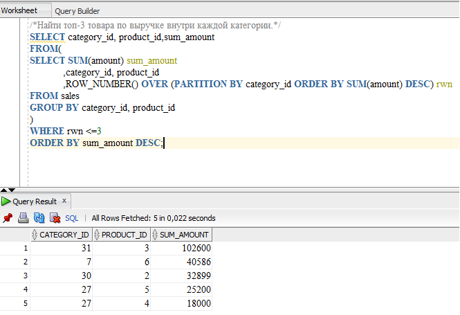

## Найти топ-3 товара по выручке внутри каждой категории.
Так как период, за который надо учитывать самые крупные по выручке товары, не указан, ,не ограничиваемся в датах продажи.

<dl>
<dt>Для начала создадим базовый(внутренний запрос), в котором:</dt>
<dd>
  <li>вычислим сумму по каждому проданному товару в каждой категории</li>
<li>Проранжируем товары внутри каждой категории
  
ROW_NUMBER() OVER (PARTITION BY category_id ORDER BY SUM(amount) DESC) rwn

  
Шаги:

<ul>
  <li>Используем оконную функцию ROW_NUMBER
  <li>отсортируем сумму по каждому товару в порядке убывания (DESC)</li>
<li>В PARTITION BY сгруппировать только категорию</li>
</ul>
<li>Сгруппируем товары в категориях и сами категории</li>
</dd>

SELECT SUM(amount) sum_amount,category_id, product_id

           
 ,ROW_NUMBER() OVER (PARTITION BY category_id ORDER BY SUM(amount) DESC) rwn

FROM sales

GROUP BY category_id, product_id

</dl>
<dl>
  <dt>
Во внешнем (итоговом запросе) выведем:
  </dt>
  <li>категорию, продукт, сумму</li>
  <li>Укажем rwn <=3, чтобы попадало не более 3 товаров в каждой категории(товаров может быть меньше 3 продано)</li>
    <li>Отсортируем по убыванию суммы</li>
</dl>
